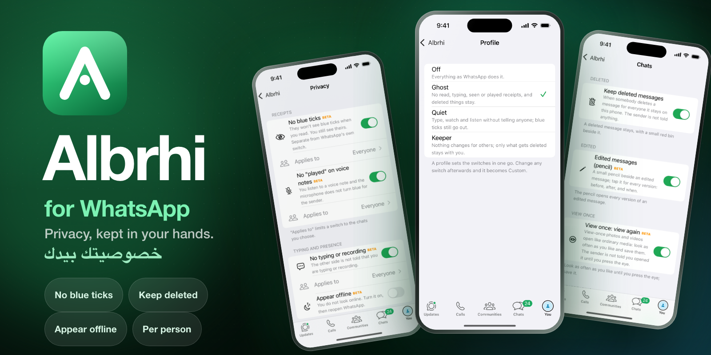
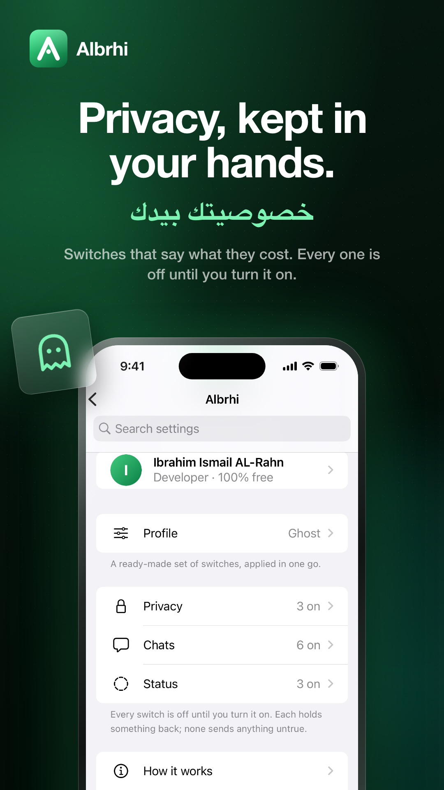
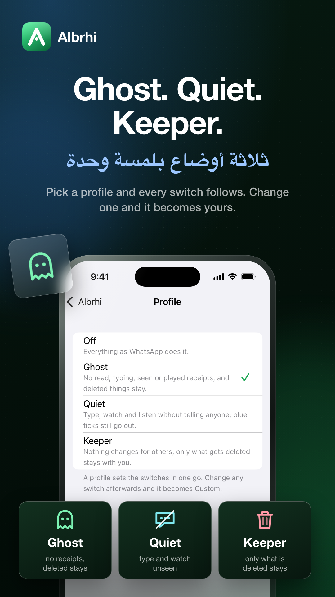
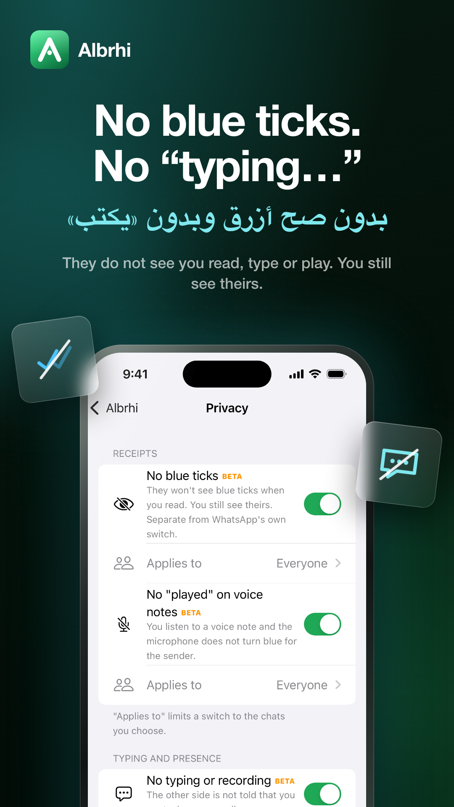
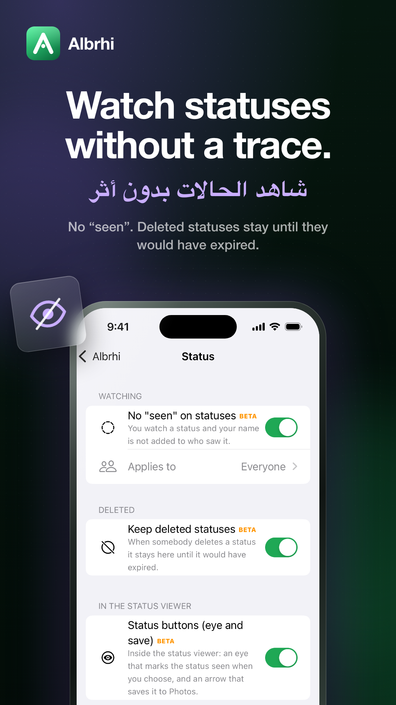

<p align="center"></p>

<h1 align="center">Albrhi for WhatsApp</h1>

<p align="center">
  <b>Privacy for WhatsApp, in your hands.</b><br>
  <span dir="rtl">خصوصيتك بيدك</span>
</p>

<p align="center">
  
  
  
  
  
</p>

The privacy switches only **withhold**: they hold back what would leave your phone, or refuse a delete order that arrives, and never send anything untrue. The other features are what you choose to turn on; the few that send something or change what the other side sees (scheduled messages, auto-reply, a chosen location) say so on their page.
Every switch is **off until you turn it on**, and says in one line what it costs.

---

## Install

1. **Let WhatsApp be tweaked.** On a jailbreak with per-app injection (roothide's tweak manager, Choicy and similar), allow tweaks in WhatsApp.
2. **Add the source** in Sileo or Zebra:
   ```
   https://ibrahim2100.github.io/albrhi-repo/
   ```
3. **Install _Albrhi for WhatsApp_.** Pick the package named **`.roothide`** on a roothide jailbreak, the other one on rootless.
   Prefer a file? Both `.deb`s are on the [Releases](../../releases/latest) page.
4. **Open WhatsApp.** The settings are a card at the top of WhatsApp's own **You** tab, and a button beside the “…” at the top of the chat list.

> [!NOTE]
> Built and tested against **WhatsApp 26.44.72**. On another version, a feature whose WhatsApp method has moved switches itself off on its own and the rest keeps working; *Settings › Tools › WhatsApp compatibility* says which.

## What it does

| | Feature | What happens | Status |
|---|---|---|---|
| 👁 | **No blue ticks** | the read receipt is not sent; you still see theirs | beta |
| 💬 | **No typing / recording** | “typing…” and “recording…” are not sent | beta |
| 🎙 | **No “played” on voice notes** | the sender's microphone stays grey | beta |
| ◌ | **No “seen” on statuses** | your name is not listed among who watched | beta |
| 🗑 | **Keep deleted messages** | a message deleted for everyone stays, with a small red bin; tap it for the whole story | **verified** |
| ✏️ | **Edited messages** | a pencil opens every version, before and after | beta |
| ⏳ | **Disappearing messages that stay** | timed messages stay, marked with an hourglass | not yet seen on a message that really expired |
| 👀 | **View once, again** | view-once photos and videos open like ordinary media; the sender is told only when you press the eye | beta |
| ◍ | **Statuses** | deleted statuses stay; the viewer gets an eye (mark seen when you choose) and an arrow (save to Photos) | save: **verified** · eye: beta |
| 👥 | **Per person, per group** | each privacy switch can apply to everyone, to chosen chats, or to everyone except them; a card on a contact's info page does it for that person | beta |
| ↪️ | **Forwarding** | hide the “Forwarded” label, and an **∞** button that lifts the five-chat limit | beta |
| 🌙 | **Appear offline** | the “online” announcement is not sent | experimental |
| 🗑 | **Deleted statuses are marked** | a deleted status you still have shows a red bin and when it was deleted, beside its time in the viewer | **verified** |
| ◍ | **Status row in Chats** | everybody's statuses in a row right under the search bar: green ring until you watch, yours first, new on the left, watched at the end; a tap opens WhatsApp's own viewer | **verified** |
| 👆 | **Chat swipe buttons** | choose the buttons under a swipe on a chat (delete, clear, mute, read, lock, favourite, block, hide, archive, more) in your order; the last runs on a full swipe; WhatsApp asks before delete, clear and block | **verified** |
| 🎨 | **Themes** | eleven colour themes (Ocean, Royal, Rose, Sunset, Gold, Graphite, Midnight…) and pure black in dark mode, by recolouring WhatsApp's green; not a re-skin: wallpapers and pictures that are green stay | beta |
| ⏱ | **Seconds in times** | message times, the chat list, the status viewer and more show seconds (9:43:27 AM) | **verified** |
| 🔐 | **App lock · hidden chats** | Face ID or your passcode to open WhatsApp; chosen chats leave the list and open after Face ID | **verified** |
| ❓ | **Ask first** | “Call X?”, “Send this sticker?”, “Send this voice message?” before it happens | **verified** |
| 🧹 | **Hide tabs · clean look** | take Updates, Calls or Communities out of the bottom bar; no floating Meta AI button; the search bar says “Search” | **verified** |
| 🗓 | **Scheduled messages · auto-reply** | write now and send at a time you pick (WhatsApp must be running); an auto-reply for chats you choose. They send real messages from your account: try them on a chat you control | scheduled: **verified** · auto-reply: beta |
| 📍 | **Fake location · HD photos · stay alive · delivery ticks · backup** | pick the place “Send my location” reads (the other side sees it); send photos at full quality; keep WhatsApp running in the background (battery); hold back the delivery tick; back up and restore your settings | beta |
| ⚙️ | **Profiles** | *Ghost*, *Quiet* and *Keeper* set the switches in one go | works |
| 🔎 | **Search** | find any switch by its words, in Arabic or English | works |

**Verified** means watched working end to end. **Beta** means hooked on the right path and counted, but not yet watched from the other side; the settings page shows a BETA tag until a feature has been.
It has been verified in the iOS Simulator (iOS 17 and iOS 26) with a real account; results from iPhones are still being collected, which is why most features are marked beta.

## A look

<p align="center">
  
  
  
  
  
</p>

<sub>The screens are the tweak's own pages, captured from the iOS Simulator. No chat, contact or message is shown.</sub>

## Good to know

- **It sends nothing of its own.** Albrhi makes no network requests; the only link it opens is one you tap on its About page. (Scheduled messages and auto-replies are sent by WhatsApp itself, only if you set them up.) What it remembers (kept messages, edit history) stays on your phone.
- **Free, closed source.** It is free to use under the terms in [LICENSE](LICENSE). The source code is not published.
- **Risk.** WhatsApp's terms do not allow modified clients, and an account can be restricted for using one. The privacy switches never send anything untrue, but you use Albrhi at your own risk. Heavy forwarding (the **∞** button) is the riskiest thing in it, and its switch says so.
- **Two buttons tell the other side you looked, on purpose:** the eye in the status viewer and the eye on a view-once message. Nothing is sent until you press one, and a receipt that has been sent cannot be taken back.

## Report a problem

Open an [issue](../../issues/new/choose). Please include the report: *Albrhi › Tools › Copy the report* (it lists which features ran and which WhatsApp methods were found; look it over before you post it).
Please do **not** post chats, names or phone numbers.

## بالعربي

**البرهي للواتساب** أداة لجوالات الجيلبريك تمنع فقط: تمسك اللي كان بيطلع من جوالك (الصحّين الزرق، «يكتب…»، «تم التشغيل» للرسائل الصوتية، «شوهدت» للحالات)، وترفض أمر حذف يوصل جوالك فتبقى الرسالة المحذوفة مع سلّة حمراء صغيرة. مفاتيح الخصوصية ما ترسل شي غير صحيح أبداً، وباقي المزايا تشغّلها بنفسك واللي يرسل شي منها (الرسائل المجدولة، الرد التلقائي، الموقع الوهمي) يقول لك في صفحته. وكل مفتاح مطفي لين تشغّله ويقول لك سطر واحد وش ثمنه.

**التثبيت:** أضف المصدر `https://ibrahim2100.github.io/albrhi-repo/` في Sileo أو Zebra، ثم ثبّت «Albrhi for WhatsApp» (حزمة `.roothide` للـroothide، والثانية للـrootless). الإعدادات في بطاقة أعلى تبويب «أنت» داخل واتساب. الواجهة بالعربي أو الإنجليزي من الإعدادات › اللغة.

مجانية، وكودها مغلق. الحالة صادقة: الميزة اللي ما انشافت تشتغل من الطرف الثاني عليها علامة BETA.

## License

Free to use for your own personal, non-commercial use, as distributed; all rights reserved by the author. See [LICENSE](LICENSE). Not affiliated with, endorsed by or connected to WhatsApp LLC or Meta; “WhatsApp” is a trademark of its owner.

<p align="center"><sub>Made by Ibrahim Ismail AL-Rahn · <a href="https://instagram.com/Ib.11p">Instagram @Ib.11p</a> · <a href="https://t.me/Ib11p">Telegram @Ib11p</a></sub></p>
